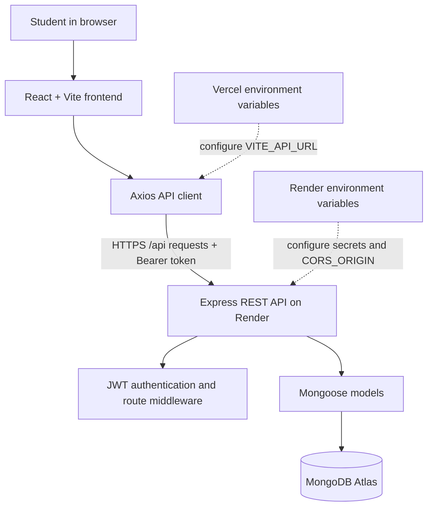
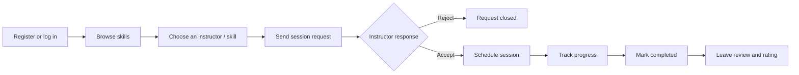

# Campus Skill Exchange

<p align="center">
  <strong>Share what you know. Learn what you need. Grow together.</strong>
</p>

<p align="center">
  A full-stack peer-to-peer learning platform that helps students share skills, find campus instructors, organize learning sessions, and review completed exchanges.
</p>

<p align="center">
  <a href="https://skill-site-p7b8.vercel.app/">Live Website</a> ·
  <a href="https://campus-skill-exchange-api-hys9.onrender.com/">Backend API</a> ·
  <a href="https://github.com/kartheeknaiduch/SKILL_SITE">Source Code</a>
</p>

---

## Overview

Students often have useful skills but no central place to find peers who can teach them. Campus Skill Exchange provides a shared space to list skills, discover instructors, request sessions, coordinate learning, and leave feedback after an exchange.

The application uses a React single-page frontend, an Express REST API, MongoDB Atlas for persistence, and JWT-based authentication.

## Features

- **Authentication:** student registration and login, password hashing, JWT-based sessions, and protected frontend routes.
- **Skill marketplace:** browse skills, view instructor information, create skill listings, and edit or delete listings.
- **Session requests:** send and receive requests, accept or reject requests, schedule sessions, and track progress through completion.
- **Instructor profiles:** view instructor details, skills, reviews, and ratings.
- **Reviews and ratings:** let learners provide feedback after a completed session.
- **Notifications:** notification endpoints and a navbar unread-count indicator.
- **Dashboard and analytics:** dashboard views and backend analytics/trending endpoints.
- **Role-aware navigation:** admin navigation is shown for users whose role is `admin`.
- **Responsive UI:** React pages styled with a shared CSS design system.

> Feature availability depends on the current implementation and database state. Real-time messaging, AI matching, and payment processing are not part of the current stack.

## Tech Stack

| Layer | Technology | Purpose |
|---|---|---|
| Frontend | React 19, JavaScript, Vite | UI and development/build tooling |
| Routing | React Router DOM | Client-side page navigation and protected routes |
| API client | Axios | HTTP requests to the backend; attaches a stored JWT as a Bearer token |
| Styling | CSS | Responsive layouts, cards, forms, gradients, and interaction states |
| Backend | Node.js, Express 4 | REST API and middleware |
| Database | MongoDB Atlas, Mongoose | Document storage and object modeling |
| Authentication | JSON Web Tokens (JWT), bcryptjs | Token-based authentication and password hashing |
| Middleware/config | cors, dotenv | Cross-origin policy and environment configuration |
| Frontend hosting | Vercel | Production frontend deployment |
| Backend hosting | Render | Public Node.js API deployment |

## Architecture



The frontend and backend are deployed separately. The frontend reads `VITE_API_URL` at build time. The backend reads private values such as `MONGO_URI` and `JWT_SECRET` from its hosting environment; secrets must never be placed in frontend variables or committed to Git.

## Main User Workflow



## Repository Structure

```text
SKILL_SITE/
├── backend/
│   ├── config/
│   │   └── db.js                 # MongoDB connection
│   ├── controllers/              # Request and business logic
│   ├── middleware/               # Authentication and route middleware
│   ├── models/                   # Mongoose schemas
│   ├── routes/                   # Express route modules
│   ├── .env.example              # Safe environment-variable template
│   ├── package.json
│   ├── seed.js                   # Optional sample-data seeding
│   └── server.js                 # Express app and API route mounting
├── frontend/
│   ├── public/                   # Static assets
│   ├── src/
│   │   ├── api/api.js            # Axios instance and JWT header
│   │   ├── components/           # Navbar, footer, and shared UI
│   │   ├── context/              # Authentication context
│   │   ├── data/                 # Static UI data
│   │   ├── pages/                # Home, skills, auth, profile, dashboard, etc.
│   │   ├── App.jsx               # Router and protected routes
│   │   ├── App.css               # Shared responsive styles
│   │   └── main.jsx              # React entry point
│   ├── index.html
│   ├── package.json
│   └── vite.config.js
├── .gitignore
└── README.md
```

## Run Locally

### Prerequisites

- Node.js and npm
- A MongoDB Atlas cluster or another MongoDB instance
- Git

### 1. Clone the repository

```bash
git clone https://github.com/kartheeknaiduch/SKILL_SITE.git
cd SKILL_SITE
```

### 2. Configure and run the backend

```bash
cd backend
npm install
```

Copy `backend/.env.example` to `backend/.env` and fill in your own values:

```env
PORT=5000
MONGO_URI=mongodb_connection_string
JWT_SECRET=use_a_long_random_secret
NODE_ENV=development
CORS_ORIGIN=http://localhost:5173,https://skill-site-p7b8.vercel.app
```

Keep `.env` private and never commit real credentials.

Start the API:

```bash
npm run dev
```

The local API listens at `http://localhost:5000`. Its health endpoint is `GET /`.

### 3. Configure and run the frontend

In a second terminal:

```bash
cd frontend
npm install
```

Create `frontend/.env` for local development:

```env
VITE_API_URL=http://localhost:5000/api
```

Start Vite:

```bash
npm run dev
```

Open the local URL printed by Vite (typically `http://localhost:5173`).

### Useful scripts

| Directory | Command | Description |
|---|---|---|
| `frontend` | `npm run dev` | Start Vite development server |
| `frontend` | `npm run build` | Build production assets |
| `frontend` | `npm run preview` | Preview the production build locally |
| `frontend` | `npm run lint` | Run ESLint |
| `backend` | `npm run dev` | Start API with nodemon |
| `backend` | `npm start` | Start API in production mode |
| `backend` | `npm run seed` | Run the optional seed script |

## Deployment

| Component | Hosting | URL |
|---|---|---|
| Frontend | Vercel | https://skill-site-p7b8.vercel.app |
| Backend | Render | https://campus-skill-exchange-api-hys9.onrender.com |
| Database | MongoDB Atlas | Private connection string stored in Render |

### Vercel frontend settings

- Root directory: `frontend`
- Framework: Vite
- Install command: `npm install`
- Build command: `npm run build`
- Output directory: `dist`
- Environment variable: `VITE_API_URL=https://campus-skill-exchange-api-hys9.onrender.com`

Vite builds the frontend at deployment time, so changes to `VITE_API_URL` require a new frontend build/deployment.

### Render backend settings

- Repository: `kartheeknaiduch/SKILL_SITE`
- Branch: `main`
- Build command: `cd backend && npm install`
- Start command: `cd backend && npm start`
- Runtime: Node.js
- Required environment variables:
  - `MONGO_URI`: MongoDB connection string
  - `JWT_SECRET`: long, random server-side signing secret
  - `NODE_ENV=production`
  - `CORS_ORIGIN`: comma-separated allowed frontend origins, including the production Vercel domain

The free Render service may spin down after inactivity, so its first request after idle time can take longer.

## API Overview

All API routes are mounted under `/api`.

| Prefix | Purpose |
|---|---|
| `/api/auth` | Registration and login |
| `/api/skills` | Skill listings and skill management |
| `/api/requests` | Session requests and their lifecycle |
| `/api/reviews` | Reviews and instructor/skill ratings |
| `/api/users` | User and instructor information |
| `/api/analytics` | Dashboard analytics and trending data |
| `/api/notifications` | Notifications and read status |

For protected endpoints, the frontend API client sends `Authorization: Bearer <token>` when a token exists in local storage. Check each route's middleware for its specific authorization requirements.

## Security Notes

- Never commit `backend/.env`, MongoDB credentials, JWT secrets, access tokens, or private keys.
- Keep server secrets in Render environment variables. Only public configuration such as `VITE_API_URL` belongs in the frontend.
- Configure MongoDB Atlas network access and database-user permissions deliberately.
- Rotate any credential that has been exposed and update the corresponding hosting environment variable.
- CORS is restricted to configured frontend origins plus local development defaults. Update `CORS_ORIGIN` when adding a new frontend domain.
- The optional seed script does not automatically create a default admin account. Use a deliberate, secure admin-provisioning process.

## Current Scope and Future Work

The current project focuses on authentication, skill listings, session requests, progress tracking, instructor profiles, reviews, notifications, and analytics scaffolding.

Potential next steps include stronger automated tests, API documentation with request/response examples, pagination and server-side filtering, more complete analytics, secure admin provisioning, richer accessibility checks, and production monitoring.

## Project Summary

Campus Skill Exchange is a full-stack MERN application built to make peer learning easier to organize on campus. It combines a React interface with a Node.js/Express API, MongoDB persistence, and JWT authentication to support a workflow from skill discovery through session completion and feedback.
